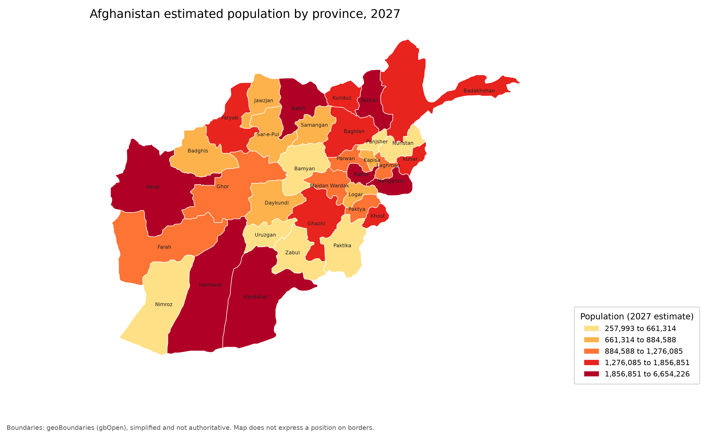

# Afghanistan province maps

Create a choropleth of Afghanistan from a CSV containing one value per province. The command writes a PNG or PDF map and a JSON sidecar that records the input hash, class breaks, and mapping details.

The Afghanistan ADM1 boundary GeoJSON is included in the repository and packaged with the Python distribution. You do not need to download boundary data or run the command from the repository root.

## Quick start

Requires Python 3.10 or newer. From the repository directory, install the tool and development dependencies. If you use Anaconda, activate your environment first.

```bash
python -m pip install -e ".[dev]"
```

Check the example CSV, then make a map:

```bash
afg-province-maps check --data examples/population_2027_ocha.csv --column population_2027
afg-province-maps map --data examples/population_2027_ocha.csv --column population_2027 --label "Population (2027 estimate)" --title "Afghanistan estimated population by province, 2027"
```

By default, the map command writes these files to `outputs/`:

- `population_2027.png`
- `population_2027_transparent.png`
- `population_2027.pdf`
- `population_2027.json`

Use `--out DIR` to choose another output folder, `--stem NAME` to choose a filename, or `--formats png` to write only PNG files (the regular and transparent versions).

## Example



Made with `afg-province-maps map --data examples/population_2027_ocha.csv --column population_2027`. Data: OCHA (Afghanistan Data Working Group), Humanitarian Data Exchange dataset `cod-ps-afg`, CC BY 4.0.

## Input CSV

The CSV must be UTF-8 and have a header row. By default, province names must be in a column called `province`. Use `--name-column` to choose a different column. Name the numeric column to map with `--column`. Other columns are ignored.

Blank numeric cells are shown as "No data". Provinces can be omitted from the CSV; they also appear as "No data" on the map.

```csv
province,population_2027
Kabul,6654226
Herat,3958782
Balkh,2802998
```

Run `check` before mapping. It checks that the requested columns exist, that province names are present and unique after name normalization, that every name matches a province in the boundary file, and that values are numeric. It does not draw a map.

```bash
afg-province-maps check --data path/to/your_data.csv --column population_2027
```

Known spelling variants are normalized, including `Ghanzi`/`Ghazni`, `Hilmand`/`Helmand`, and `Maidan Wardak`/`Wardak`. If a name is not recognized, `check` and `map` report it and point to `src/afg_province_maps/names.py`, where aliases can be added.

## Classifying values

The default is five quantile classes. Quantiles put roughly the same number of provinces in each class, which is useful when values such as population are strongly skewed.

```bash
# Five equal-width value ranges
afg-province-maps map --data examples/population_2027_ocha.csv --column population_2027 --scheme equal

# Fixed class edges, so maps stay comparable across years
afg-province-maps map --data examples/population_2027_ocha.csv --column population_2027 --bins 0,1000000,2000000,4000000,7000000
```

- `--classes N` sets the number of classes for quantile or equal schemes. The default is 5.
- `--scheme quantile` or `--scheme equal` selects the classification method.
- `--bins EDGE,...` supplies explicit class edges. Values below or above the outer edges are placed in the first or last class.
- `--cmap NAME` selects a matplotlib colormap. The default is `YlOrRd`.

## Command reference

```text
afg-province-maps check --data FILE --column COLUMN [--name-column NAME] [--boundaries PATH]
afg-province-maps map --data FILE --column COLUMN [--name-column NAME]
    [--label TEXT] [--title TEXT]
    [--bins EDGE,... | --classes N --scheme quantile|equal]
    [--cmap NAME] [--boundaries PATH]
    [--out DIR] [--stem NAME] [--formats png,pdf]
```

`--boundaries PATH` is optional. Use it only when you want to map against a different boundary file. The default ADM1 GeoJSON is bundled with the tool and works regardless of the current working directory.

## Outputs

The PNG and PDF use the same classified values and include a legend in a separate panel at the lower right, outside the map. Provinces with no numeric value use a grey fill.

The JSON sidecar records the input filename and SHA-256 hash, the selected value and name columns, the class method and edges, the map title, the colormap, the boundary filename and SHA-256 hash, and the provinces without data. Keep it with the map when you need to reproduce or audit the output.

## Development

```bash
python -m pip install -e ".[dev]"
pytest
```

The test suite covers CSV validation, province-name normalization and matching against the boundary file, rejection of invalid `--bins` and formats, the bundled boundary data, and creation of PNG, PDF, and JSON outputs using the default GeoJSON.

## Data sources and limitations

Maps and data are provided for general information. Check the original sources before relying on a map.

- **Boundaries:** simplified Afghanistan ADM1 geometry from geoBoundaries, included as GeoJSON in this repository and in the installed package. The boundaries represent the situation in 2007 and are not authoritative. See [`data/boundaries/README.md`](data/boundaries/README.md) and [`THIRD_PARTY_NOTICES.md`](THIRD_PARTY_NOTICES.md) for the release, access date, and licence.
- **Example population data:** `examples/population_2027_ocha.csv` contains OCHA's interim estimate of population by province for 2027, from the Afghanistan Data Working Group via the Humanitarian Data Exchange (dataset `cod-ps-afg`, CC BY 4.0). It is included to demonstrate the tool, not to support analysis. The estimates are not a census, and they are not directly comparable with earlier estimates. Cite OCHA and the dataset name when you publish results.
- **Code licence:** the code is licensed under MIT. See [`LICENSE`](LICENSE). This licence does not cover the boundary file or the example data.
